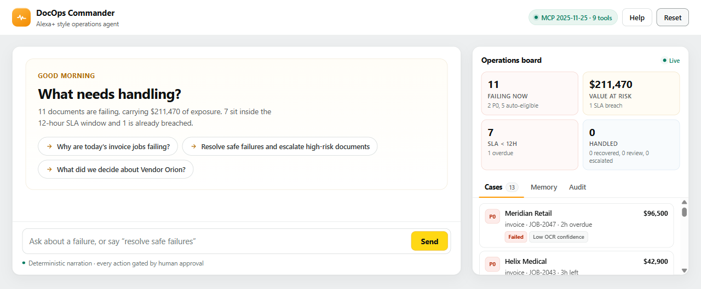
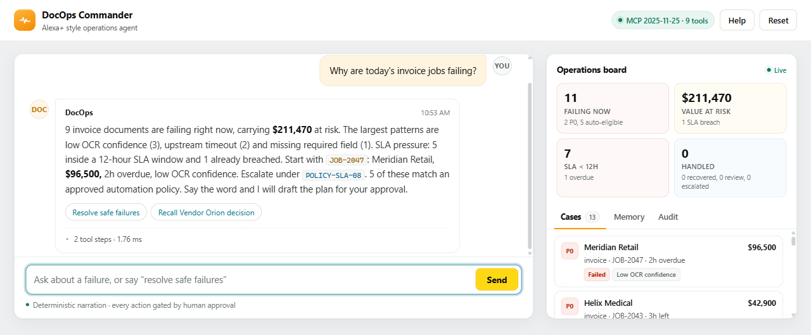
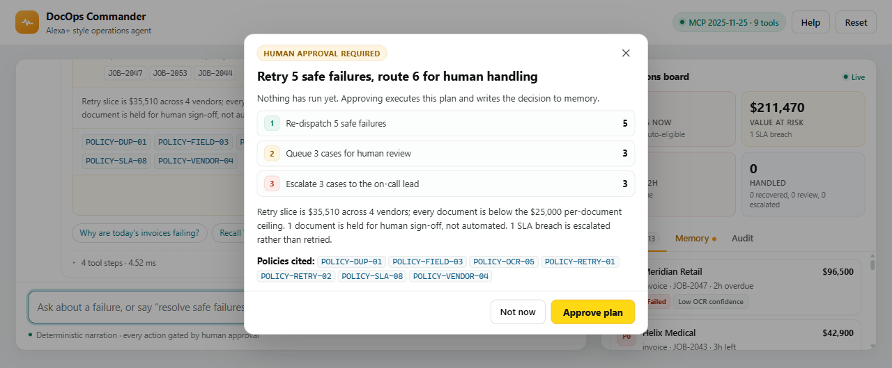
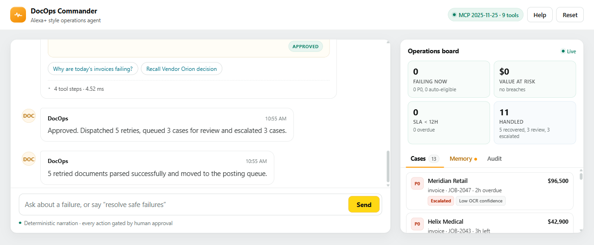
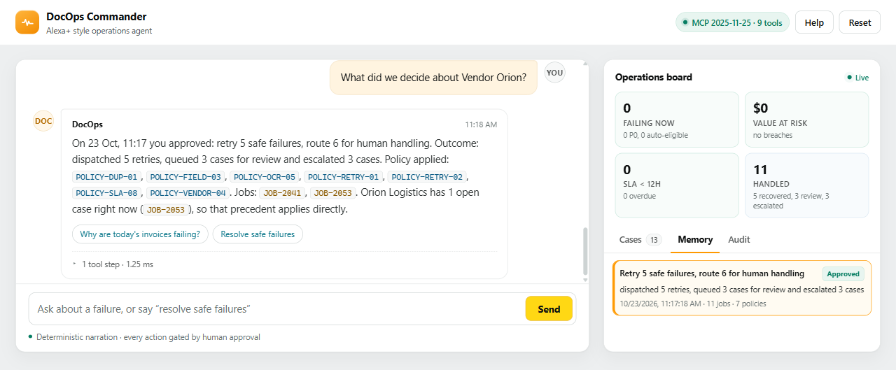

# DocOps Commander

**An Alexa+ style operations agent for document-processing failures — shipped as a self-hosted MCP server, with a light operator console that is itself an MCP client.**

Document operations teams do not need another failure dashboard. They need to know **which cases are safe to automate, which need a person, and what was decided last time**. DocOps Commander answers that in one conversational pass, drafts a policy-cited plan, and executes only after a human approves.

Built for the **Build, Ship, Shape: Amazon Developer Hackathon — Alexa+ track**, with synthetic data only.



## Why it qualifies for the Alexa+ track

| Requirement | How this project meets it |
|---|---|
| Working agent or self-hosted MCP server | MCP server at `POST /mcp`, **protocol `2025-11-25`**, Streamable HTTP |
| The web page must be a real MCP client | The console performs `initialize` → `notifications/initialized` → `tools/list` → `tools/call`; every rendered panel comes from `structuredContent` |
| Tool discovery | Nine tools with JSON Schemas, descriptions and `structuredContent` results |
| Human control | `draft_resolution_plan` cannot execute; `approve_plan` is the only executor and refuses a second approval |
| Durability | Plans and outcomes live in SQLite and are recallable across sessions |
| No paid services required | Deterministic narration by default; no LLM key, no network, no npm |

## What it does

1. **Diagnoses** failures by pattern — OCR confidence, missing fields, vendor master-data mismatch, schema errors, upstream timeouts — with SLA pressure and dollar exposure, scoped to what you asked about.
2. **Prioritises** cases by SLA risk, value and failure class.
3. **Drafts** a three-segment plan (retry · human review · escalate) that cites the seven policies applied and explains the risk.
4. **Waits.** Nothing executes until a human approves. Rejection is recorded just as durably.
5. **Remembers** the decision and answers follow-ups such as “What did we decide about Vendor Orion?” with the original plan, jobs, policies and outcome.

## Quick start

```bash
python -m venv .venv
.\.venv\Scripts\activate          # Windows (bash: source .venv/bin/activate)
pip install -r requirements.txt

python -m uvicorn backend.main:app --host 127.0.0.1 --port 8010
```

Open **http://127.0.0.1:8010**. The SQLite database and the 17-job synthetic dataset are created on first start. No API key is required.

> If `uvicorn` is not on your PATH, use `python -m uvicorn …` exactly as above.

## Verify it in 30 seconds

With the server running:

```bash
python scripts/smoke_test.py    # 37 checks: diagnosis scope, approval gate, plurals,
                               # recovery, memory, honest recall miss, reset
python scripts/mcp_smoke.py     # 28 checks: handshake, session header, 9 tools,
                               # schemas, approval gate, double-approval refusal,
                               # JSON-RPC errors, GET /mcp -> 405, reset
```

Both are standard-library only and exit non-zero if anything regresses.

## MCP tools

| Tool | Purpose |
|---|---|
| `orchestrate` | Natural-language entry point; returns reply, cards, stats, trace, pending approval |
| `get_board` | Every open case, aggregate stats, memory, audit |
| `diagnose_jobs` | Group failing jobs, optionally by `doc_type` or `vendor` |
| `prioritise_cases` | Rank open cases by SLA risk, value, failure class |
| `draft_resolution_plan` | Build the three-segment plan and an `action_id`; executes nothing |
| `approve_plan` | **The only executor.** Runs the plan and records the decision |
| `reject_plan` | Declines the plan and records the rejection |
| `recall_decisions` | Search decision memory by vendor or free text |
| `reset_demo` | Restore the synthetic dataset and clear memory |

The server also exposes `GET /api/meta`, which advertises the endpoint, transport, protocol version and tool list.

## Demo commands

| Say this | What happens |
|---|---|
| `Why are today's invoice jobs failing?` | Scoped diagnosis: 9 invoices, $211,470 at risk, policy citations, recommended first case |
| `Resolve safe failures and escalate high-risk documents` | Approval-gated plan: retry 5 · review 3 · escalate 3, citing 7 policies |
| Click **Approve plan** | 11 jobs move; 5 retries recover after ~3 s; audit and memory update |
| `What did we decide about Vendor Orion?` | Recalls the approved decision, matched jobs highlighted in the Memory tab |
| `Hold everything for manual triage` | Records a hold decision; no jobs move |
| **Reset demo** | Restores 11 failing jobs and clears memory |

## Screenshots

| | |
|---|---|
|  **Diagnosis** — scoped counts, patterns, SLA pressure |  **Approval gate** — segments, risk note, policy chips |
|  **Executed** — 11 handled, 5 recovered, audit trail |  **Recall** — matched decision highlighted |

## Design

- **Light, Amazon-style palette** — `#EDEFF0` page, `#131A22` ink, `#FF9900` brand, `#FFD814` primary CTA. No dark mode; the brief asked for light.
- **Two-pane console** on desktop, single column under 900 px; the shell fits a 1280×800-class viewport without page scroll.
- **Conversation first** — every action is a sentence; option chips appear only when the next step is genuinely ambiguous.
- **Approval is visible** — inline plan card, compact modal, and an “Approved” receipt state instead of a disappearing dialog.
- **Feedback never shifts layout** — toasts and typing indicators overlay; the board updates in place.
- **Accessibility** — semantic landmarks, `aria-live` conversation, `aria-pressed` tabs, focus-trapped modal, visible focus rings, `prefers-reduced-motion` respected, no colour-only meaning.

## Project structure

```
docops-commander/
├─ backend/
│  ├─ mcp_server.py     # Streamable HTTP MCP server, 9 tools, JSON-RPC dispatch
│  ├─ main.py           # FastAPI app, REST surface, static mount
│  ├─ planner.py        # intent → orchestration → narration → state payload
│  ├─ tools.py          # diagnosis, prioritisation, batching, execution, memory
│  ├─ domain.py         # policy engine and case construction
│  ├─ db.py             # SQLite: decisions, pending actions, messages, audit
│  ├─ dataset.py        # synthetic 17-job dataset
│  ├─ llm.py            # optional narration polish (deterministic no-op)
│  └─ config.py         # thresholds and runtime settings
├─ frontend/            # index.html, styles.css, app.js (MCP client + UI)
├─ data/sample_jobs.json
├─ docs/                # architecture, demo script, feedback, friction log, submission
├─ scripts/             # smoke_test.py, mcp_smoke.py
├─ final-0*.png         # submission screenshots
├─ LICENSE              # MIT
└─ requirements.txt
```

## How it is put together

See [docs/ARCHITECTURE.md](docs/ARCHITECTURE.md) for the transport details, tool contracts, policy order, data model and design decisions. The short version:

```
console (MCP client) ──POST /mcp──▶ mcp_server ──▶ planner ──▶ tools ──▶ SQLite
                                        │
                                        └── domain: policy engine (first match wins)
```

Everything the UI shows is a tool result. There is no second implementation path.

## Submission status

| Item | Status |
|---|---|
| Public GitHub repo, MIT license | ⬜ publish before submitting (local commit ready) |
| Demo video < 3 minutes | ⬜ record from [docs/DEMO_SCRIPT.md](docs/DEMO_SCRIPT.md) |
| Devpost write-up, field by field | ✅ [docs/SUBMISSION.md](docs/SUBMISSION.md) |
| Product feedback per tool | ✅ [docs/FEEDBACK.md](docs/FEEDBACK.md) |
| Feature requests with priority | ✅ [docs/SUBMISSION.md](docs/SUBMISSION.md#3-product-feedback-required-per-tool) |
| 2–3 friction log entries | ✅ [docs/FRICTION_LOG.md](docs/FRICTION_LOG.md) |
| Synthetic data only | ✅ |
| Runs with no API key | ✅ |
| Verified flows | ✅ 37 HTTP + 28 MCP checks passing |

## License

MIT — see [LICENSE](LICENSE).
